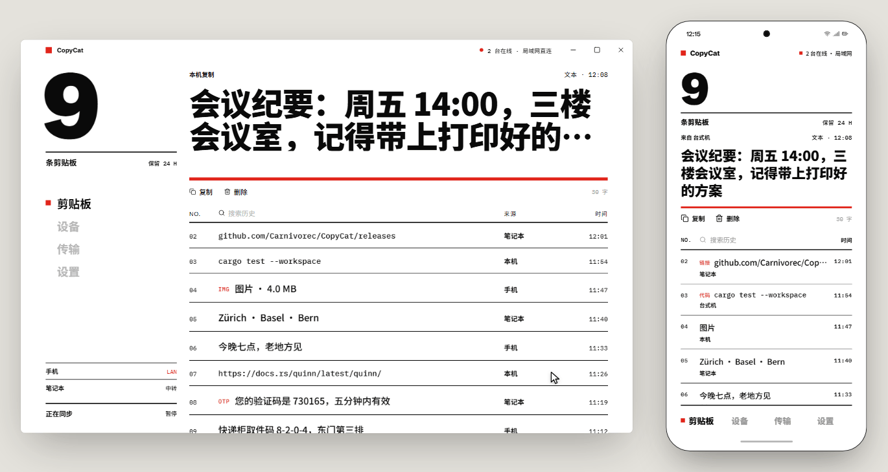
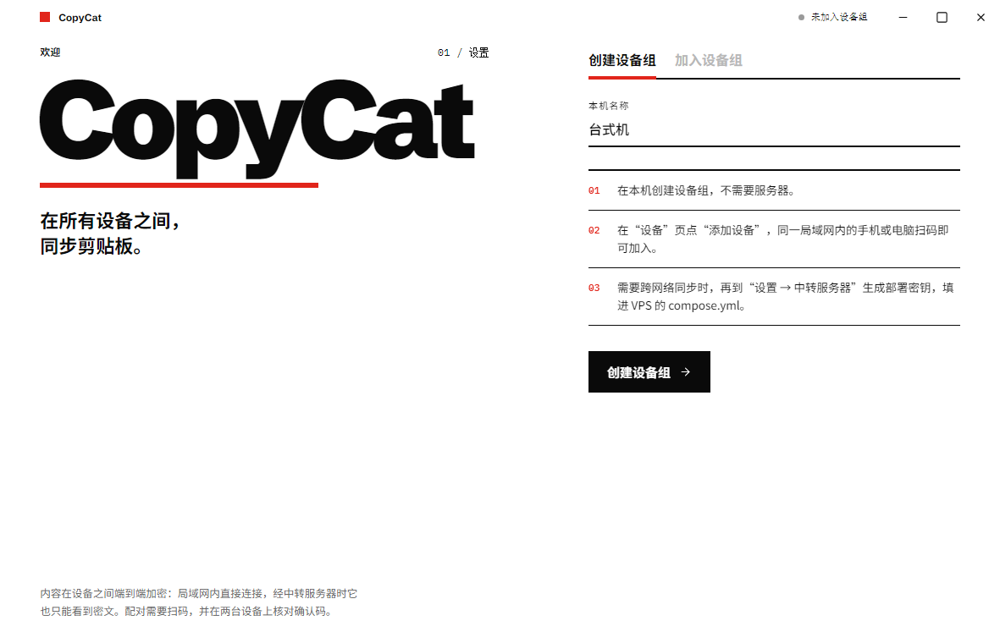
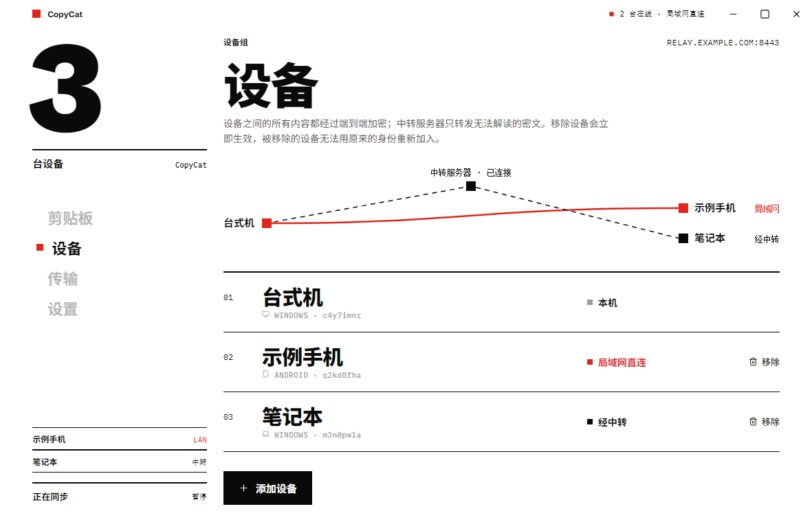
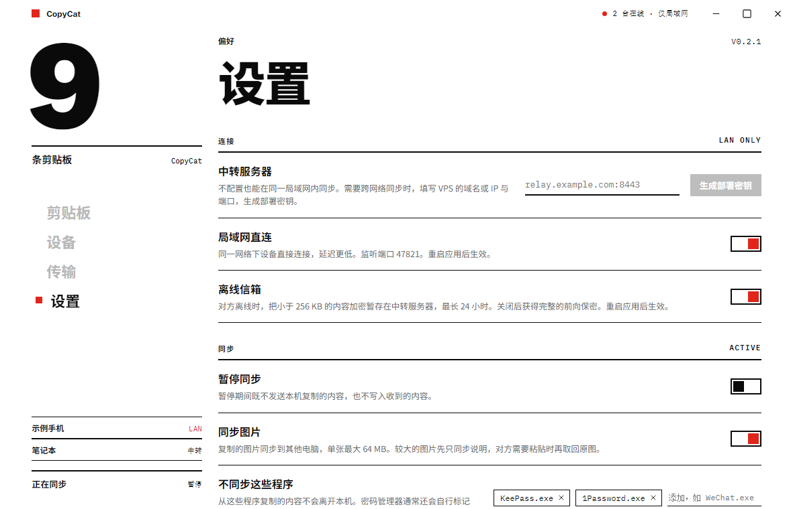

  

<h1 align="center">CopyCat</h1>

最丝滑的 Windows ⇄ Android 剪贴板与文件同步工具。端到端加密，支持局域网直连，也支持 VPS 中转。

## 特色

### 丝滑的动画

### 多样的功能

- 多设备剪贴板无缝同步
- 电脑截图瞬间同步到手机
- VPS 中转连接，跨网络同步
- 安卓开机无缝自启动
- 手机电脑快速互传文件
- 手机分享链接到电脑，一键打开
- 端到端加密
- 密码等敏感内容不自动同步

## 使用要求

- 由于安卓系统限制，目前**仅支持 KernelSU root 的安卓手机，暂不支持无 root 安卓手机**。

## 下载

前往 [Releases](https://github.com/Carnivorec/CopyCat/releases/latest) 下载最新版本：

- **Windows**：`CopyCat_<版本>_x64-setup.exe`
- **Android**：`CopyCat_<版本>_android-arm64.apk`，安装后在 KernelSU 中为 CopyCat 授予 root 权限
- **中转服务器**（可选）：Docker 镜像 `ghcr.io/carnivorec/copycat-relay`，部署方法见下文第 3 步

## 快速上手

### 1. 第一台电脑：创建设备组

**桌面应用**：首次打开选“创建设备组”。

### 2. 添加其他设备

在同一个局域网内：

**桌面应用**：在“设备”页点“添加设备”，显示二维码与配对码（120 秒有效）。手机打开 CopyCat 扫码；另一台电脑的桌面应用选“加入设备组”并粘贴配对码。两端核对 6 位确认码一致后，在邀请方点“确认一致，同意加入”。

### 3. （可选）添加中转服务器，跨网络同步

先将域名 DNS 解析到服务器，注意请使用“仅 DNS”，不要开启 Cloudflare 小黄云等代理功能，然后在防火墙与安全组中放行 8443 端口（UDP 与 TCP 都要放行）。

打开桌面应用，选择“设置 → 中转服务器”，填入 `域名:8443`，点“生成部署密钥”。

一键生成 `compose.yml` 文件（端口与密钥已经填好）。在 VPS 上新建目录，下载仓库中的 [`deploy/docker/setup.sh`](deploy/docker/setup.sh)，把复制的内容保存为同目录下的 `compose.yml`，运行 `bash setup.sh` 即可自动拉取镜像并启动。
